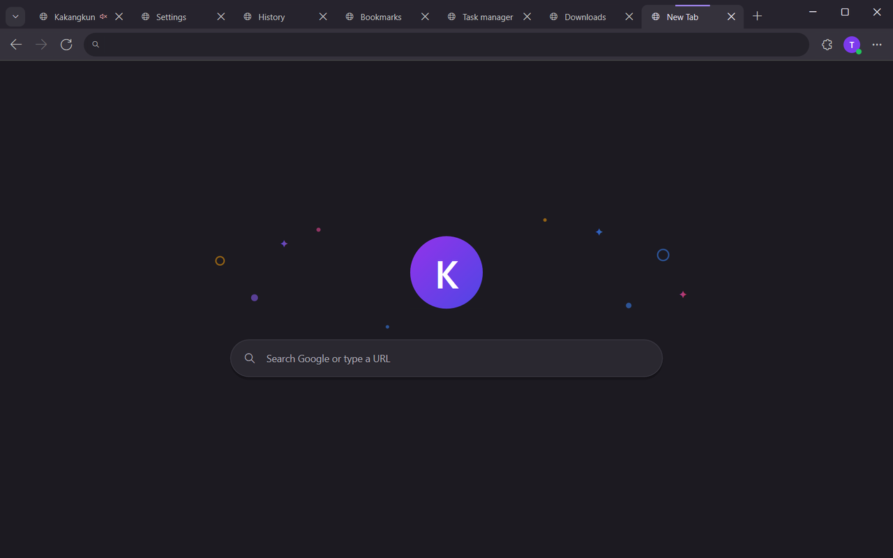
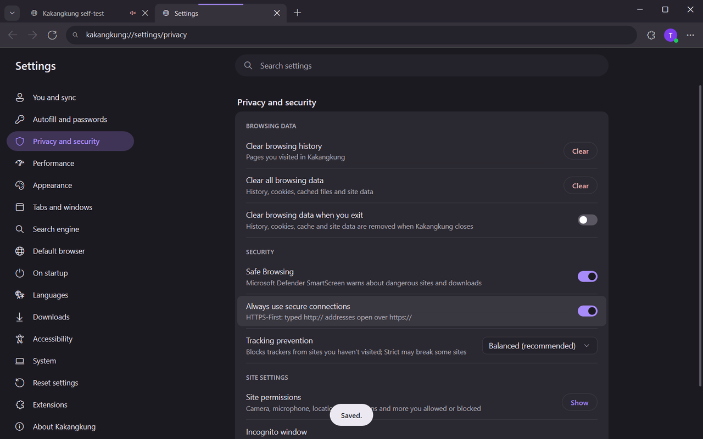
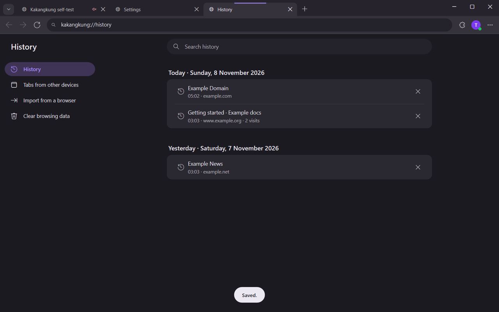
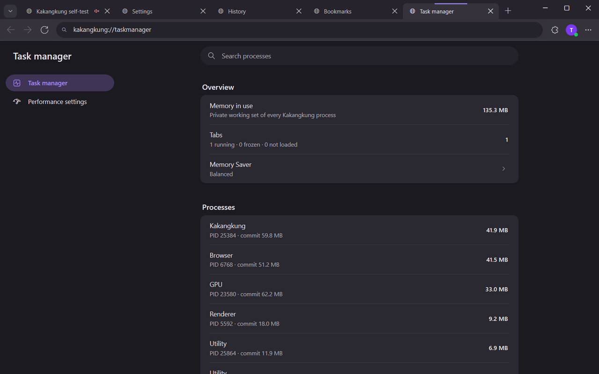
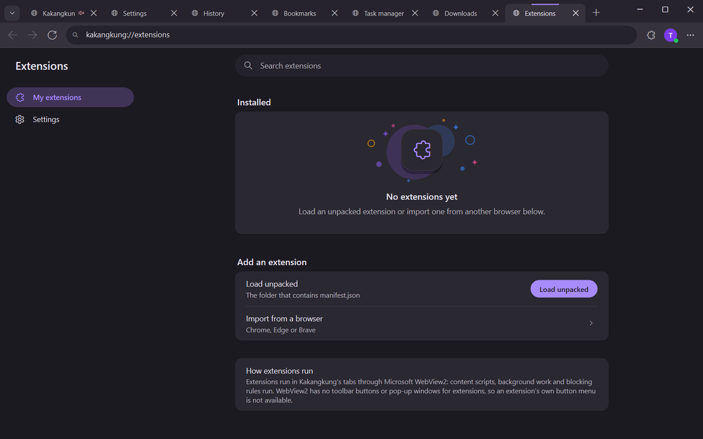

<p align="center">
  
</p>

<h1 align="center">Kakangkung</h1>

<p align="center">
  A light, fast web browser for Windows, written in Rust, with a native interface.
</p>

<p align="center">
  <a href="https://github.com/revanapriyandi/kakangkung/releases/latest"></a>
  <a href="https://github.com/revanapriyandi/kakangkung/actions/workflows/ci.yml"></a>
  <a href="LICENSE"></a>
  
</p>

<p align="center">
  
</p>

Kakangkung draws its whole interface itself — tab strip, toolbar, address bar, menus, pop-ups and
every built-in page — with Direct2D, like Chrome and Edge do. Only web pages are rendered by the
engine, Microsoft Edge WebView2 (Chromium). There is no HTML in the browser's own UI, so a tab that
shows Settings or History has no page process at all.

## Download

Get the installer for your PC from the **[latest release](https://github.com/revanapriyandi/kakangkung/releases/latest)**:

| Your PC | File |
|---|---|
| Windows 10/11, Intel or AMD (most PCs) | `Kakangkung-Setup-<version>-x64.exe` |
| Windows 11 on ARM (Snapdragon) | `Kakangkung-Setup-<version>-arm64.exe` |
| No installation (portable) | `Kakangkung-<version>-<x64 or arm64>.zip` |

The installer needs no administrator rights, installs Microsoft Edge WebView2 when the PC does not
have it, and **keeps Kakangkung up to date automatically**: new versions are downloaded in the
background, checked against their SHA-256, and installed when you close the browser — or at once
with ⋮ > *Restart to update*. Details: [docs/INSTALL.md](docs/INSTALL.md),
[docs/UPDATES.md](docs/UPDATES.md).

> Windows only. Kakangkung is built on Win32, Direct2D and WebView2; macOS and Linux are not
> supported.

## Features

- **Tabs** in the title bar: groups, pinning, muting, split view (two tabs side by side), drag to
  reorder, reopen closed tabs (Ctrl+Shift+T), session restore.
- **Tab search** (⌄ at the start of the tab strip, or Ctrl+Shift+A): open tabs by recent use and
  recently closed ones.
- **Address bar** with inline completion from history and bookmarks plus live search suggestions;
  search engine of your choice (Google, Bing, DuckDuckGo, Yahoo!, Ecosia, Brave, or your own).
- **Built-in pages**, native and laid out like Chrome's: Settings (one page per section, with
  search), History, Bookmarks, Downloads, Extensions, Task manager, Account and Sync, Welcome
  (import from other browsers).
- **Memory Saver** freezes tabs you have not looked at for a while; tabs playing sound, in a call
  or pinned are left alone. The **task manager** shows the real memory of every process.
- **Extensions from the Chrome Web Store**: on an extension's page the store's button reads
  *Add to Kakangkung*; the toolbar's extensions button lists them and opens their pop-ups.
  Unpacked extensions and imports from other browsers work too.
- **Sign in with Google**: bookmarks, history, open tabs and settings sync between your PCs through
  a hidden app folder in your Google Drive — see [docs/GOOGLE_SIGNIN.md](docs/GOOGLE_SIGNIN.md).
  Google's own sign-in works on websites, including sign-in pop-ups.
- **Built-in ad blocker** (on by default, *Settings > Privacy and security > Block ads*): requests
  to known ad networks never leave the browser. Tracking prevention handles trackers.
- **Incognito windows**, **import** of history, bookmarks and extensions from Chrome, Edge, Brave
  and Firefox.
- **Every feature has a setting** — see [docs/SETTINGS.md](docs/SETTINGS.md) — including light/dark
  mode, animations and their speed, smooth scrolling and automatic updates.

<p align="center">
  
  
</p>
<p align="center">
  
  
</p>

## How it stays light

WebView2 uses the same multi-process model as Chrome (browser, GPU, network, renderer processes),
so a web page costs about what it costs in Chrome. The savings come from everything around it:

- The interface is native: no web views for the tab strip, menus or built-in pages. The New Tab
  page alone takes about 25 MB; one web page about 115–125 MB for all processes together.
- Small surfaces are drawn by the CPU, so the browser keeps no extra graphics devices.
- The window shows in under 100 ms; the engine starts behind it.
- Memory Saver freezes idle tabs; restored tabs stay unloaded until you open them.

Measurements and how they were taken: [docs/NATIVE_UI.md](docs/NATIVE_UI.md#memory-start-up-motion-and-art).

## Build from source

You need Windows 10/11, the Visual Studio C++ build tools with a Windows SDK, and Rust (the
toolchain is pinned in `rust-toolchain.toml`).

```powershell
git clone https://github.com/revanapriyandi/kakangkung
cd kakangkung
cargo run --release
```

More, including the installer, the self-test and ARM64 builds: [docs/BUILDING.md](docs/BUILDING.md).

## Project layout

```
crates/app/        the browser: window, tabs, built-in pages (native/), updater, self-test
crates/platform/   all Windows code (the only crate with `unsafe`): native frame, pop-ups and
                   pages (Direct2D), menus, WebView2, downloads, HTTP, SQLite, SHA-256
crates/ui/         address-bar input, shortcuts, security state, the logo
crates/tabs/       tab lifecycle state machine (active, idle, frozen, discarded)
crates/memory/     Memory Saver modes and protection rules
crates/storage/    history, bookmarks, settings, import from other browsers, sync
installer/         Inno Setup installer
docs/              settings, design notes, building, releasing, updates
```

## Contributing

Contributions are welcome — bug reports, ideas, code, translations of the docs. Start with
[CONTRIBUTING.md](CONTRIBUTING.md); issues labelled
[good first issue](https://github.com/revanapriyandi/kakangkung/labels/good%20first%20issue) are a
good place to begin. Questions go to
[Discussions](https://github.com/revanapriyandi/kakangkung/discussions), security problems to
[SECURITY.md](SECURITY.md).

## License

[MIT](LICENSE). Kakangkung is not affiliated with Google or Microsoft; see [CREDITS.md](CREDITS.md).
