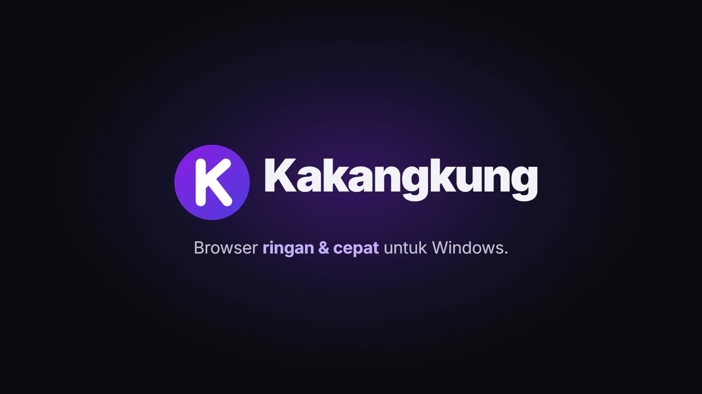

<p align="center">
  
</p>

<h1 align="center">Kakangkung</h1>

<p align="center">
  A light, fast web browser for Windows, written in Rust, with a native interface.
</p>

<p align="center">
  <a href="https://github.com/revanapriyandi/kakangkung/releases/latest"></a>
  <a href="https://github.com/revanapriyandi/kakangkung/actions/workflows/ci.yml"></a>
  <a href="LICENSE"></a>
  
</p>

<p align="center">
  
</p>

<p align="center">
  <a href="docs/videos/kakangkung-promo.mp4"></a><br>
  <a href="docs/videos/kakangkung-promo.mp4"><b>▶ Watch the 30-second promo</b></a>
</p>

Kakangkung draws its whole interface itself — tab strip, toolbar, address bar, menus, pop-ups and
every built-in page — with Direct2D, like Chrome and Edge do. Only web pages are rendered by the
engine, Microsoft Edge WebView2 (Chromium). There is no HTML in the browser's own UI, so a tab that
shows Settings or History has no page process at all.

## Download

Get the installer for your PC from the **[latest release](https://github.com/revanapriyandi/kakangkung/releases/latest)**:

| Your PC | File |
|---|---|
| Windows 10/11, Intel or AMD (most PCs) | `Kakangkung-Setup-<version>-x64.exe` |
| Windows 11 on ARM (Snapdragon) | `Kakangkung-Setup-<version>-arm64.exe` |
| No installation (portable) | `Kakangkung-<version>-<x64 or arm64>.zip` |

The installer needs no administrator rights, installs Microsoft Edge WebView2 when the PC does not
have it, and **keeps Kakangkung up to date automatically**: new versions are downloaded in the
background, checked against their SHA-256, and installed when you close the browser — or at once
with ⋮ > *Restart to update*. Details: [docs/INSTALL.md](docs/INSTALL.md),
[docs/UPDATES.md](docs/UPDATES.md).

> Windows only. Kakangkung is built on Win32, Direct2D and WebView2; macOS and Linux are not
> supported.

## Features

- **Tabs** in the title bar: site icons, a turning ring while loading, groups, pinning, muting,
  split view (two tabs side by side), drag to reorder, a strip that scrolls when there are dozens
  of tabs, reopen closed tabs (Ctrl+Shift+T), session restore.
- **Menus and dialogs of its own**, with icons, keyboard (↑ ↓ ← → Enter Escape), dark mode and
  animation; submenus open beside the menu, and zoom sits in the menu as − 100% +.
- **Tab search** (⌄ at the start of the tab strip, or Ctrl+Shift+A): open tabs by recent use and
  recently closed ones.
- **Tab hover cards** show the title, address, last page snapshot and a memory measurement.
  Eight small snapshots are retained in memory; hovering a sleeping tab does not wake it.
  On runtimes affected by WebView2 frame-attribution crashes, the card explicitly shows only
  the JavaScript heap, excluding images, video and GPU allocations.
- **Address bar** with inline completion from history and bookmarks plus live search suggestions;
  search engine of your choice (Google, Bing, DuckDuckGo, Yahoo!, Ecosia, Brave, or your own).
- **Built-in pages**, native and laid out like Chrome's: Settings (one page per section, with
  search), History, Bookmarks, Downloads, Extensions, Task manager, Account and Sync, Welcome
  (import from other browsers).
- **Password manager** of its own: offers to save a password after you sign in, fills it in from
  a list under the login field, and shows a key in the address bar. Passwords are sealed with your
  Windows account; showing, copying or exporting one asks Windows Hello. Import from Chrome, Edge,
  Brave and other browsers, or from the CSV export of Google Password Manager, Firefox, Safari,
  Bitwarden, 1Password, LastPass, Proton Pass, Dashlane or NordPass; export to CSV. Passkeys work
  through Windows Hello, a security key or your phone.
- **PDF viewer and files**: PDFs open in the tab (zoom, search, rotate, two-page view, print,
  save, and drawing on local files), as do pictures, video, audio, JSON and text. Ctrl+O opens a
  file from your PC, Kakangkung is offered under *Open with* for PDF files, and a downloaded PDF,
  picture or video opens in a tab.
- **Memory Saver** freezes tabs you have not looked at for a while; tabs playing sound, in a call
  or pinned are left alone. New profiles use Maximum (30 seconds for unprotected hidden tabs).
  The **task manager** totals private working set for the app and
  its WebView2 runtime processes; Windows may display those processes in different groups.
  Measured against Chrome and Edge with 1 to 100 real sites: [docs/BENCHMARKS.md](docs/BENCHMARKS.md).
- **Extensions from the Chrome Web Store**: on an extension's page the store's button reads
  *Add to Kakangkung*, and adding one asks first with what it can do, like Chrome. The toolbar's
  extensions button lists them and opens their pop-ups; pin the ones you use to the toolbar.
  Unpacked extensions and imports from other browsers work too.
- **New Tab page** with a working search box and shortcut tiles of your most visited sites, each
  with its own icon.
- **Sign in with Google**: bookmarks, history, open tabs and settings sync between your PCs through
  a hidden app folder in your Google Drive — see [docs/GOOGLE_SIGNIN.md](docs/GOOGLE_SIGNIN.md).
  Google's own sign-in works on websites, including sign-in pop-ups.
- **Built-in ad blocker** (on by default): the toolbar shield controls global blocking and
  exact-site exceptions. A shared native matcher uses bundled EasyList/EasyPrivacy network rules;
  a small page helper hides clearly identified ad elements and removes known YouTube player ad
  instructions. Filter coverage varies with site changes; embedded sponsorships and every ad on
  every site are not guaranteed. [Filter sources and refresh](assets/filterlists/README.md).
- **Developer tools inside the browser**: F12/Ctrl+Shift+I and the page's Inspect command open
  a bottom panel. This uses Windows child-window hosting because WebView2 exposes a separate
  DevTools window; if hosting fails, Kakangkung reports the error and closes that inspector.
- **Incognito windows**, **import** of history, bookmarks and extensions from Chrome, Edge, Brave
  and Firefox.
- **Every feature has a setting** — see [docs/SETTINGS.md](docs/SETTINGS.md) — including light/dark
  mode, animations and their speed, smooth scrolling and automatic updates.

<p align="center">
  
  
</p>
<p align="center">
  
  
</p>

## How it stays light

Current feature behavior and verification limits, including the difference between
Kakangkung sync and Chrome Sync: [docs/CHROME_PARITY.md](docs/CHROME_PARITY.md).

WebView2 uses the same multi-process model as Chrome (browser, GPU, network, renderer processes),
so a web page costs about what it costs in Chrome. The savings come from everything around it:

- The interface is native: no web views for the tab strip, menus or built-in pages. A native
  New Tab needs no WebView2 process; opening a website starts the shared engine and its
  renderer/GPU services. Current isolated whole-process measurements and their limits:
  [bench/memory-probe-findings.md](bench/memory-probe-findings.md).
- Small surfaces are drawn by the CPU, so the browser keeps no extra graphics devices.
- The window shows in under 100 ms; the engine starts behind it.
- Memory Saver freezes idle tabs; restored tabs stay unloaded until you open them.

Measurements and how they were taken: [docs/NATIVE_UI.md](docs/NATIVE_UI.md#memory-start-up-motion-and-art).

## Build from source

You need Windows 10/11, the Visual Studio C++ build tools with a Windows SDK, and Rust (the
toolchain is pinned in `rust-toolchain.toml`).

```powershell
git clone https://github.com/revanapriyandi/kakangkung
cd kakangkung
cargo run --release
```

More, including the installer, the self-test and ARM64 builds: [docs/BUILDING.md](docs/BUILDING.md).

## Project layout

```
crates/app/        the browser: window, tabs, built-in pages (native/), updater, self-test
crates/platform/   all Windows code (the only crate with `unsafe`): native frame, pop-ups and
                   pages (Direct2D), menus, WebView2, downloads, HTTP, SQLite, SHA-256
crates/ui/         address-bar input, shortcuts, security state, the logo
crates/tabs/       tab lifecycle state machine (active, idle, frozen, discarded)
crates/memory/     Memory Saver modes and protection rules
crates/storage/    history, bookmarks, settings, import from other browsers, sync
installer/         Inno Setup installer
docs/              settings, design notes, building, releasing, updates
```

## Contributing

Contributions are welcome — bug reports, ideas, code, translations of the docs. Start with
[CONTRIBUTING.md](CONTRIBUTING.md); issues labelled
[good first issue](https://github.com/revanapriyandi/kakangkung/labels/good%20first%20issue) are a
good place to begin. Questions go to
[Discussions](https://github.com/revanapriyandi/kakangkung/discussions), security problems to
[SECURITY.md](SECURITY.md).

## License

[MIT](LICENSE). Kakangkung is not affiliated with Google or Microsoft; see [CREDITS.md](CREDITS.md).
